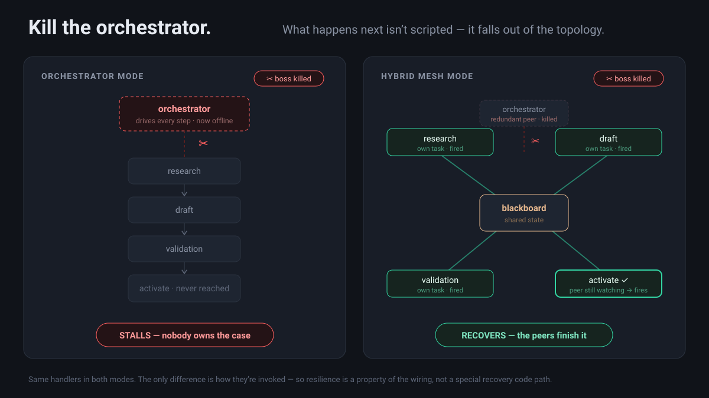
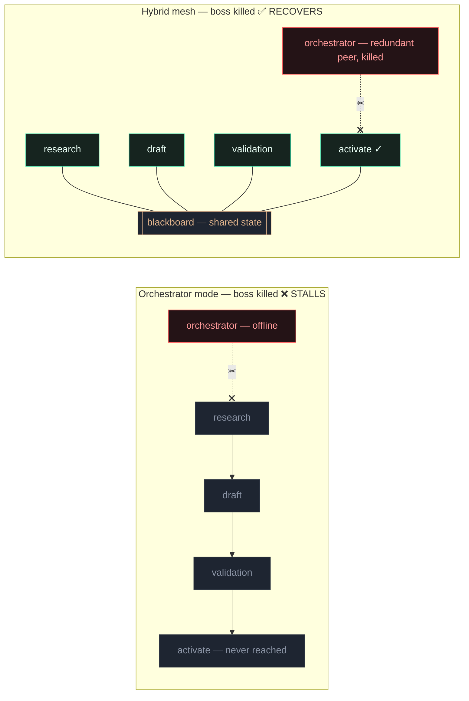

# Agent ops console — live sandbox

A self-contained demo backend for the "kill the orchestrator" moment. The kill is
**real**: the orchestrator is an actual `asyncio` task and the kill command
`cancel()`s it. What happens next isn't scripted — it falls out of the topology.

Different pieces, different setup:

| Demo | How to run | Requirements |
| --- | --- | --- |
| Poison-write (standalone) | `python3 backend/poison_demo.py` | none — pure standard library, no venv, no API key, fully offline |
| Kill-the-coordinator (web app) | `python app.py` | a virtualenv + `pip install -r backend/requirements.txt` |
| Finale (optional, in the web app) | type a goal, **Compose** | an `ANTHROPIC_API_KEY`; without one it falls back to a recorded plan, so nothing breaks |

- **Orchestrator mode** — one task drives research → draft → validation → activate
  in sequence. Kill it and the sequence stops mid-flight. Nothing owns the case,
  so it **stalls**.
- **Hybrid mesh mode** — every handler is its own task watching a shared dict (the
  blackboard) and fires when its trigger condition is met. The orchestrator is a
  redundant peer that only makes the final "activate" call. Kill it and the other
  handlers, still running, carry the case to completion on their own — recovery
  **emerges**, it isn't a special code path.

Everything the agents "produce" is fake — tiny hardcoded dicts/strings on the
blackboard. No model calls, no external services. Fully offline. The point is
topology resilience, not output.

## How it works



The same four handlers — research, draft, validation, activate — run in **both**
modes. The only thing that changes is *how they're invoked*. That single
difference is why one mode dies when you kill the boss and the other doesn't.



1. **The kill is real.** The orchestrator is an actual `asyncio` task; the kill
   command `cancel()`s it. Nothing about the aftermath is scripted — no
   `reroute()` that plays canned steps.
2. **Orchestrator mode** wires the handlers as one linear chain owned by the boss:
   `research → draft → validation → activate`. Cancel the boss and the chain
   freezes mid-flight. Nobody owns the remaining steps, so the case **stalls**.
3. **Hybrid mesh mode** runs each handler as its own task blocked on a shared
   blackboard, firing when its trigger predicate goes true. The orchestrator is
   just a *redundant peer* on the final `activate` call. Cancel it and the other
   watchers — still running — carry the case to done. Recovery **emerges**.
4. **Why the recovery is honest:** cancelling the orchestrator removes one of two
   watchers on the final trigger. The activation peer is still watching the same
   dict, so it fires. The `orch_alive` flag only decides which link the UI
   animates — it never decides whether a handler runs.

The **finale** goes one step further: type an unseen goal and one real model call
(forced-tool `emit_plan`) composes a fresh plan, which the backend validates and
then executes on the model's own dependency graph — with the kill switch still
live. See [Finale](#finale--the-self-writing-planner-the-one-real-model-call) below.

## The other demo — the cost of the mesh (poison write)

The kill demo shows the mesh *winning*. This one shows it losing, with no one
killed. One handler succeeds but writes a plausible, well-shaped, **wrong** result
to the shared state — it does not crash, it does not raise. The same poison write
is run against three topologies:

- **Orchestrator** — a validation **gate** at the merge point rejects the bad
  audience before the irreversible `activate`. Poison caught, nothing fires.
- **Mesh (unscoped)** — no gatekeeper, and every handler reads the *whole* board,
  so the poison reaches handlers that never needed it (even the brief-only
  `assets` / `legal`). Widest blast radius; the external action fires.
- **Mesh (scoped)** — no gatekeeper either, but least-privilege reads: each
  handler sees only the keys it declared, so the collateral reads disappear and
  the blast radius shrinks.

The fault is injected by a **wrapper** around one handler's output — the handlers'
own logic is never edited, so the "identical handlers in every topology" claim
still holds. The run prints a per-handler trace (who wrote what, who read it, where
it stopped or how far it spread) and a blast-radius count. Deterministic, offline,
no new dependencies.

Same poison write, three topologies:

| topology         | gate? | reads           | handlers hit | external actions |
| ---------------- | ----- | --------------- | ------------ | ---------------- |
| orchestrator     | yes   | declared        | 2            | 0 (blocked)      |
| mesh (unscoped)  | no    | whole board     | 5            | 1                |
| mesh (scoped)    | no    | least-privilege | 3            | 1                |

The takeaway: the **gate** is what prevents harm; **scoping** limits the spread but
does not replace validation. You want both. Run it (pure stdlib — no venv, no key):

```bash
python3 backend/poison_demo.py
```

### What about a crash before the gate?

A question from a reader: *a validation gate stopped the poison write, while scoping
only reduced collateral reads — what evidence do you keep when a worker dies after
touching shared state but before the gate runs?*

The gate and scoping are both **runtime** guards — scoping limits *who can read*, the
gate blocks an unvalidated value from the irreversible step. Neither is **forensics**.
A worker that writes to the board and then dies *before the gate runs* is the
intersection of both demos: a write of unknown validity is on the board, and the thing
that would judge it is gone — in the orchestrator, the dying worker can be the very
coordinator that runs the gate, so it never fires and the case stalls with the value
still sitting there.

You can't interrogate a dead worker, so the evidence has to live in the write itself. A
board built for this records, per write:

- **provenance** — who wrote it, when, and from which inputs, so blast radius is
  reconstructable after the writer is gone;
- **a `validated` bit, default false** — the value is "written but unjudged" until a
  gate stamps it; the *absence* of a gate-pass is itself the evidence it died unvalidated;
- **a read log** — who consumed the key before the gate ran; in the mesh, that ledger
  *is* the blast radius;
- **write intent** — the atomicity boundary, so a torn write (`k1` written, `k2` not)
  isn't mistaken for a complete one.

With those, a mid-flight death leaves an honest trail — *written, never validated, read
by X and Y* — which is enough to **quarantine and recompute**: the payloads are derived,
so you re-run from the last validated input and never need the dead worker.

In this sandbox the blackboard is a plain last-write-wins dict. The only evidence it
keeps is the ordered `bb` write-event stream (how the UI mirrors state) and the
role-tagged case log — *who wrote what, in what order*, but **no `validated` bit and no
read log**. That's deliberate (a topology demo, not a durability one), and it's the same
"no provenance" property that lets the mesh spread the poison in the first place. So the
argument has three controls, not two: **scoping contains, the gate prevents, and a
provenance log is what lets you recover** — and the crash-before-gate case is the one
that needs the third.

**This is live in the web demo.** Run **Poison**, then hit **Kill** to crash the
coordinator before the gate — the **blackboard** tab shows the surviving evidence:
each write tagged with its writer, whether it was `validated` / `rejected at gate` /
still `unvalidated`, and who read it. Let a Poison run finish instead and you see the
gate stamp `audience` *rejected* (orchestrator) or every key stay *unvalidated* and
the read-by list fan out (mesh). The blackboard is provenance-carrying only on the
Poison path; a normal Run/Kill leaves it a plain dict, as before.

## Layout

```
backend/app.py         FastAPI app + /ws websocket endpoint
backend/agents.py      blackboard + worker handlers + both run modes + kill + plan reveal
backend/planner.py     the FINALE — one real Anthropic call, forced emit_plan, validation
backend/scenarios.py   the two scenario configs (log text + tiny fake payloads + catalog)
backend/poison_demo.py the poison-write / blast-radius demo (standalone CLI, stdlib only)
frontend/index.html    the existing UI, rewired to consume the ws feed
```

## Finale — the self-writing planner (the one REAL model call)

Everything above is scripted-but-emergent topology with fake payloads. The finale
is where composition is genuinely model-generated. Type an unseen goal, hit
**Compose plan**, and the backend:

1. Calls the Anthropic API (`claude-opus-5`) with **forced tool use** — `tool_choice`
   pinned to an `emit_plan` schema — handing the model a **fixed capability catalog**
   per scenario. Small `max_tokens`, wrapped in an **8s timeout**.
2. **Validates** the returned steps: catalog membership, dependency refs, no cycles.
3. Ships the whole plan as one `plan` event: the steps, the dependency graph, and
   two rendered artifacts.

The frontend then **swaps the topology for a graph built from the plan itself** —
nodes = steps, edges = `depends_on`, laid out by dependency depth and revealed in
topological order (~300ms stagger). So an unseen goal visibly reshapes the graph.
`capability:"custom"` steps (things the catalog can't cover) render as **amber
nodes**. Alongside it, a **Generated by claude** panel shows what the model produced:

- **`plan.json`** — the raw `emit_plan` artifact (steps + `depends_on` + rationale).
- **`plan.py`** — a deterministic async-Python rendering of the same plan (one
  coroutine per step, wired by `depends_on`; custom steps become `NotImplementedError`).

**Reset** returns to the run/kill topology.

- **REAL** = the composition (which capabilities, what order, the dependency graph) — model-generated.
- **FAKE** = the step payloads (tiny hardcoded blobs in `scenarios.py`) and the derived `plan.py`. No real external services.
- Any failure — no key, timeout, API error, or an invalid/cyclic plan — degrades to a
  **recorded plan** (`recorded_plan` per scenario) so the demo never breaks. The graph
  caption says which path ran (`composed live` vs `recorded fallback`).

Set the key in the environment before launching — it is never exposed to the frontend:

```bash
export ANTHROPIC_API_KEY=sk-ant-...
```

Without it, the finale still works and shows the recorded-plan fallback path.

New client → backend command: `{"cmd":"plan","scenario":"campaign","goal":"<unseen task>"}`.

## Run

The **poison-write** CLI is a single command, no setup:

```bash
python3 backend/poison_demo.py         # blast-radius trace across the three topologies
```

The **kill-the-coordinator** and **poison-write** demos are both the web app (poison
also runs live there, with provenance in the blackboard tab — see above):

```bash
cd backend
python3 -m venv .venv && source .venv/bin/activate
pip install -r requirements.txt
python app.py            # or: uvicorn app:app --port 8000
```

Open http://127.0.0.1:8000 — the frontend connects back to `/ws` automatically.

## Drive the demo

Pick a **scenario** (top-right) and a **mode** (orchestrator / hybrid mesh), then
inject a fault — the *same fault* produces opposite outcomes per topology:

| | **Kill** the coordinator | **Poison** write |
| --- | --- | --- |
| **Orchestrator** | stalls | caught at the merge gate |
| **Mesh** | recovers | spreads (blast radius) |

- **Run case**, then **Kill** mid-run — orchestrator freezes (*stalled*, red); mesh
  hands off peer-to-peer and finishes without the boss (*recovered*, amber).
- **Poison** — one handler returns a plausible, wrong result. Orchestrator's merge
  gate rejects it (0 external actions); mesh has no gate, so it spreads to every
  handler that reads the key and the external action fires (logged, not executed).
- **Compose a plan…** reveals the finale — type an unseen goal and watch it compose
  and run (see below).

The poison button is the web version of `backend/poison_demo.py`; the CLI adds the
third (scoped-mesh) topology and the full blast-radius trace.

## Event protocol (backend → frontend)

```
{"type":"node",  "id":"res",      "state":"active|done|off|idle"}
{"type":"link",  "id":"orch_res", "state":"flow|reroute|dead|off"}
{"type":"log",   "role":"orch|res|dra|val|system|done", "text":"...", "cls":"good|warn|reroute|"}
{"type":"status","text":"...", "cls":"stalled|recovered|"}
```

Client → backend:

```
{"cmd":"run","scenario":"campaign","mode":"mesh"}
{"cmd":"kill"}
```

## Why the mesh recovery is honest

There is no `reroute()` that plays canned steps. The three workers and the
activation step are the **same handlers** in both modes; in mesh they simply run
as independent tasks whose triggers are predicates over the shared blackboard.
Cancelling the orchestrator removes one of two watchers on the final trigger —
the activation peer is still watching the same dict, so it fires. The `orch_alive`
flag only chooses which link the UI animates (boss link vs. peer link); it never
decides whether a handler runs. See the header comment in `backend/agents.py`.
